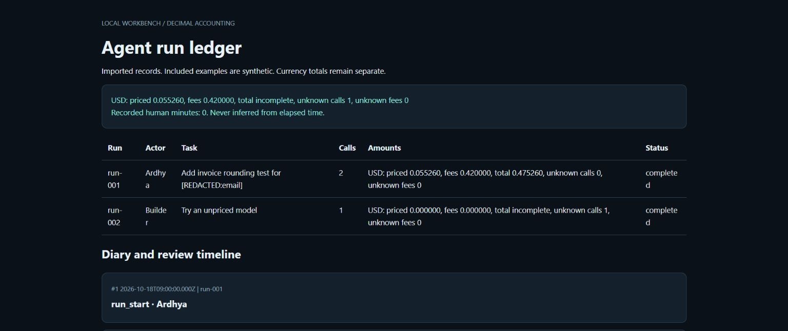

# Run Ledger

A local workbench for decimal agent-run accounting, a redacted diary and an attributed review timeline. Included records and model prices are synthetic.

```sh
python -m pip install -e ".[dev]"
runledger ingest fixtures/runs.jsonl --db ledger.db --prices fixtures/prices.json
runledger report --db ledger.db --format html --out ledger.html
runledger verify --db ledger.db
```



## Accounting rules

- Input tokens include cached tokens. Cached tokens cannot exceed input tokens.
- Preserve raw Decimal costs. Round only after aggregation, to six decimal places with half-up rounding.
- Keep currency balances separate. No exchange rate is assumed.
- Missing model prices and null fee amounts produce incomplete totals, never an invented zero bill. Known subtotals remain visible.
- Each call retains its price-table version. Example prices are not current vendor prices.
- Record human effort only through explicit `human_time` events, with an actor and decimal-string `minutes`.

## Diary and review

The JSONL event types are `run_start`, `llm_call`, `tool_call`, `diary`, `review`, `fee`, `human_time` and `run_end`. Diary, review and start events require an actor. Review decisions are `approved`, `rejected` or `changes_requested`.

Timestamps require a timezone and normalize to UTC. Text, actor names and nested metadata pass through pattern-based redaction before storage. Secret-valued metadata fields are replaced entirely. The HTML report is self-contained, escapes imported text and includes diary notes and review decisions. Review the export before sharing.

A file import is atomic and repeated identical normalized events are skipped. The hash chain detects changes relative to the stored chain, including envelope edits in new version-2 rows. It does not attest event truth, prevent a complete rewrite or detect tail truncation without a trusted external checkpoint. Legacy rows protect payload only.

## Formats

See `fixtures/runs.jsonl` and `fixtures/prices.json` for complete examples. Price amounts are decimal strings and the schema is `PRICE_TABLE_V1`. Unknown fees use an explicit `amount: null` plus a currency. Reports expose `RUN_SUMMARY_V2`, with `totals.amounts` and each run's `amounts` keyed by currency. Each balance has `priced_subtotal`, `known_fees`, unknown counters and a nullable `total`.

```json
{"type":"human_time","run_id":"demo","at":"2026-10-19T09:00:00Z","actor":{"id":"reviewer","name":"Reviewer","role":"reviewer"},"minutes":"12.5","note":"Reviewed the synthetic fixture"}
```

## Verification and limits

Run `python -m pytest -q`. The 19 tests cover the original workflow and six audit regressions: aggregation precision, currency separation, unknown fees, nested redaction, atomic ingestion, envelope tampering, explicit human effort and boundary validation. See [audit corrections](docs/AUDIT.md).

Single local SQLite writer, no billing integration, automatic budget enforcement or claims of comprehensive secret detection. Event ordering is retained as imported; elapsed time does not imply human effort. Old ledgers retain previously rounded historical amounts. No historical values are silently repriced.

MIT. See LICENSE.
